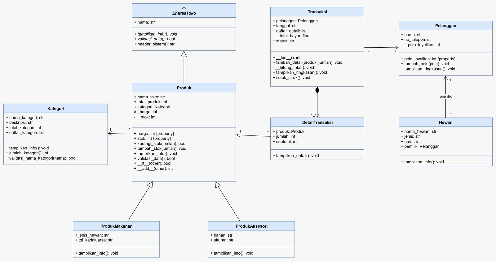

# Laporan Posttest - Pemrograman Berorientasi Objek (PBO)

## Identitas 
- **Nama**: Syarifah Anargya Rizky (Gea)
- **NIM**: 2509106007
- **Mata Kuliah**: Pemrograman Berorientasi Objek
- **Program Studi**: Informatika
- **Universitas**: Universitas Mulawarman

---

## 1. Judul dan Deskripsi Singkat Program
- **Judul Program**: Sistem Manajemen Penjualan Petshop & Pendataan Pet Hotel Berbasis OOP.
- **Deskripsi Singkat**: 
  Program ini merupakan kelanjutan dari tugas-tugas sebelumnya dengan menambahkan implementasi modul terbaru yaitu **Abstraksi (*Abstract Base Class*)**, **Polimorfisme** (*method overriding*, *duck typing*, dan *operator overloading*), serta kelengkapan relasi UML (**Asosiasi, Agregasi, dan Komposisi**). Sistem ini dirancang untuk mengelola data produk petshop, hewan, pelanggan, hingga pencatatan transaksi secara terstruktur.

---

## 2. Class Diagram & Penjelasan Relasi UML
Berikut adalah rancangan struktur kelas (*Class Diagram*) yang saya buat di Draw.io dan dimasukkan ke dalam program:

### Penjelasan Detail Relasi UML:
1. **Asosiasi (`Hewan` $\rightarrow$ `Pelanggan`)**:
   * **Penjelasan**: Menghubungkan kelas `Hewan` dengan kelas `Pelanggan` sebagai pemilik hewan (`pemilik`).
   * **Alasan Pemilihan**: Kedua kelas ini dapat berdiri sendiri sebagai objek mandiri, namun objek hewan memerlukan referensi ke objek pelanggan untuk mengetahui siapa pemiliknya.
2. **Agregasi / Komposisi (`Transaksi` $\rightarrow$ `DetailTransaksi`)**:
   * **Penjelasan**: Menghubungkan kelas `Transaksi` dengan rincian `DetailTransaksi`.
   * **Alasan Pemilihan**: Menggunakan relasi komposisi karena objek `DetailTransaksi` dibentuk dan dikelola sepenuhnya di dalam siklus hidup objek `Transaksi`. Jika transaksi dihapus, rincian detailnya akan ikut terhapus.

---

## 3. Penerapan Abstraksi dan Polimorfisme

### A. Abstraksi (*Abstract Base Class* / ABC)
- **Abstract Class**: Saya membuat kelas `EntitasToko` yang mewarisi `ABC`.
- **Abstract Methods**: Memiliki 2 method abstrak wajib yaitu `tampilkan_info()` dan `validasi_data()`.
- **Implementasi Subclass**: Method tersebut wajib di-*override* oleh kelas anak seperti `Produk`, `ProdukMakanan`, dan `ProdukAksesori`.
- **Bukti Abstraksi (Try-Except TypeError)**: Diuji menggunakan blok `try-except` untuk membuktikan bahwa abstract class tidak dapat diinstansiasi secara langsung.

### B. Polimorfisme
1. **Polimorfisme via Pewarisan**: Method `tampilkan_info()` di-*override* di kelas `ProdukMakanan` dan `ProdukAksesori` sehingga menghasilkan output berbeda meskipun dipanggil lewat 1 perulangan `for` yang sama.
2. **Duck Typing**: Diterapkan melalui fungsi `tampilkan_ringkasan(objek)` yang bisa menerima objek `Pelanggan` atau `Transaksi` secara dinamis selama memiliki method yang sesuai.
3. **Operator Overloading**: Menggunakan magic method `__lt__` untuk perbandingan harga (`<`) dan `__add__` untuk penjumlahan total harga (`+`), serta `__len__` untuk fungsi `len()`.

---

## 4. Screenshot Output Program
*(Masukkan screenshot terminal hasil run program kamu di sini, sesuaikan dengan nama file gambarnya)*

---

## 4. Penghindaran Anti-Pattern
Dalam program ini, saya sepenuhnya menghindari penggunaan rantai `if / elif` yang mengecek tipe objek (`type()`) atau string jenis secara manual. Penentuan perilaku cetak informasi dilakukan secara mandiri oleh masing-masing objek melalui *method overriding* `tampilkan_info()` pada loop polimorfik.

---

## 5. Nilai Plus: Penerapan Prinsip SOLID
Program ini menerapkan prinsip **Open/Closed Principle (OCP)** dan **Dependency Inversion Principle (DIP)**:
- **Open/Closed Principle (OCP)**: Penambahan jenis produk baru (misalnya produk obat atau vitamin) dapat dilakukan hanya dengan membuat kelas turunan baru dari `Produk` tanpa perlu mengubah kode inti pada superclass `Produk` atau logika transaksi yang sudah ada.
- **Dependency Inversion Principle (DIP)**: Kelas `Transaksi` bergantung pada abstraksi objek `Produk` yang disuntikkan dari luar (*dependency injection*) melalui method `tambah_detail(produk, jumlah)`, bukan membuat instansiasi objek produk secara langsung di dalam kelas transaksi.